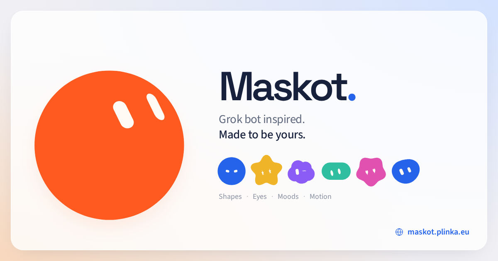

<p align="center">
  <a href="https://maskot.plinka.eu">
    
  </a>
</p>

<h1 align="center">Maskot</h1>

<p align="center">A little character studio. A lot of personality.</p>

<p align="center">
  <a href="https://maskot.plinka.eu">Open Maskot</a> ·
  <a href="https://plinka.eu">Made by Plinka</a> ·
  <a href="LICENSE.md">MIT license</a>
</p>

Create an expressive SVG mascot, give it a look of its own and bring it to life. Maskot is a free, open-source browser studio inspired by the Grok bot and built on the mascot engine from Bloub and Beam.

Choose a silhouette, shape its eyes, explore its moods and compose a motion sequence. Export your character as a vector, a transparent image or a video. Your work stays in your browser.

## Make it yours

| Appearance                                        | Movement                                           | Export                                           |
| ------------------------------------------------- | -------------------------------------------------- | ------------------------------------------------ |
| 32 silhouettes, from bubbles to stars and flowers | 29 movements, Thinking Orbs and animated symbols   | Standalone SVG                                   |
| 32 eye styles and 32 expressions                  | Editable timeline, playback, looping and scrubbing | Transparent PNG                                  |
| Eye size, proportions, spacing, color and blush   | Reorder clips, adjust durations, undo and redo     | WebM with transparent, white or black background |
| Custom colors saved locally                       | A die for a new look or a random ten-clip sequence | Video encoding in the browser with Mediabunny    |

The workspace keeps the character at the center. Floating controls and live previews make it easy to explore different looks; SVG changes morph between their shapes. On mobile, the properties open in a draggable bottom drawer and the timeline scrolls horizontally.

The interface is available in **English and French**, with light, dark and system themes. Motion preferences are respected. No account or remote rendering service is required.

> WebM export requires a browser with the WebCodecs features used by the encoder. The export dialog reports unsupported browsers.

## Run locally

Use the Bun version declared in `package.json` and Node.js 24 or newer.

```sh
bun install --frozen-lockfile
bun run dev
```

Open **http://localhost:8400**. The port is strict; stop the existing development server before starting another on the same port.

```sh
bun run check         # Types, lint, formatting, unit tests and production build
bun run build         # Static site, pre-rendered HTML and bundled assets in dist/
bun run preview       # Serve the production build on port 8400

bunx playwright install chromium
bun run test:browser  # Browser interactions, mobile layouts and real exports
```

`bun run lint` combines Oxlint with the official React Hooks and Compiler checks. `bun run format` formats the project with Oxfmt. `bun run bench:engine` measures the mascot engine. Browser tests use a separate preview server; `MASKOT_TEST_PORT` can override its port.

## Under the hood

**React 19 · React Compiler · TypeScript · Vite · Bun · Jotai · Motion · shadcn/ui / Base UI · Tailwind CSS · i18next · Mediabunny**

Space Grotesk and Source Sans 3 are served locally. The production build includes pre-rendered content, social sharing metadata and the HTML-rendered Open Graph image shown above.

```text
src/
  mascot/
    engine/          Framework-independent geometry and animation
    thinking-orbs/   Local orb engine and presets
                     SVG renderer, playback, validation and exports
  state/             Jotai state, history, preferences and persistence
  components/        Studio controls and shared UI primitives
  styles/            Design tokens and application styles
tests/               End-to-end browser scenarios
public/licenses/     Third-party notices distributed with the site
```

The engine owns geometry and animation sampling; React owns the interface. Playback updates avoid rebuilding the whole properties panel. Color picking uses transient updates, previews are memoized, and video encoding is loaded when needed. Local storage preserves the character, timeline, palette and preferences.

The application builds independently: a separate Beam checkout is not needed.

## Credits

- **[Grok bot](https://x.ai/)** — the original character idea and visual inspiration. Maskot is an independent project.
- **[Bloub](https://github.com/jeremy-prt/bloub)** by Jérémy Perret — the foundation for the SVG mascot engine, movements and editor layout.
- **[Beam](https://github.com/BeamRecorder/Beam)** — the original mascot workshop, ported to React for Maskot.
- **[Thinking Orbs](https://github.com/Jakubantalik/thinking-orbs)** by Jakub Antalik — orb geometry and animation presets, integrated locally.
- **[Mediabunny](https://github.com/Vanilagy/mediabunny)** — browser video encoding and WebM export.
- **[ReUI](https://reui.io/components/color-picker)** — the color picker, adapted to the studio.

The About page includes an English **Credits & licenses** dialog with the full acknowledgements, fonts and dependency notices.

Maskot’s own code is licensed under [MIT](LICENSE.md). Third-party code, fonts and assets retain their respective licenses; see [the distributed notices](public/licenses/NOTICE.txt).
